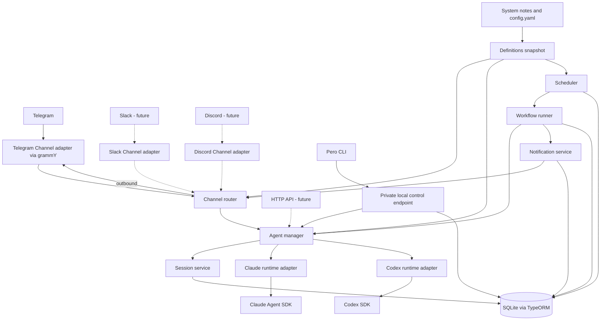

# Pero architecture

## 1. Purpose and scope

Pero is a personal, self-hosted assistant that accepts conversation through Channels, each answered with the settings and instructions of its Channel note, and performs background work through Workflows. Telegram is the first Channel integration; each topic of the owner's Telegram group is one Channel, as are the group's General topic and a direct chat with the bot. A single installation serves one owner. The architecture leaves room for Slack, Discord, and other communication integrations later.

**Deployment:** one globally installed `pero` CLI, one background NestJS service, a workspace whose Markdown notes and `config.yaml` configure it, and one SQLite database on persistent local storage for its state. `pero run` starts the service; `pero stop` stops it; management commands such as `pero channels ls` use the same application services. No mandatory PostgreSQL, Redis, external queue, or workflow engine. See the [CLI contract](./CLI.md).

## 2. Domain vocabulary

| Concept | Meaning |
|---|---|
| **Persona and Instructions** | `Persona.md`, Pero's personality, and `Instructions.md`, its general instructions: two body-only notes that every turn's instructions include, in every Channel and Workflow Run, after the context and before the Channel note's own. |
| **Channel note** | A note in `Channels/`, such as `Health.md`, bound to its Channel by `channel-id` (`<integration>:<address>`): the Channel's provider and provider options (model, effort), permissions, working directory, and, as its body, the Channel's own instructions. `Default.md` has no `channel-id` and answers every primary Channel: General topics, groups without topics, and direct chats. A Channel note is not a running process. |
| **Agent Runtime** | Adapter that executes a turn using a provider SDK and normalizes the result: `ClaudeRuntime` uses Claude Agent SDK, `CodexRuntime` uses Codex SDK. |
| **Channel** | A transport-independent conversation endpoint, answered with its Channel note's settings. In Telegram, one topic, the General topic, or a direct chat is one Channel; a new topic with no note gets one, bound to it. Slack threads or Discord channels can map to Channels too. |
| **Session** | Persistent conversational context for a Channel, keyed by the Channel alone, including the provider's session/thread ID. Interactive turns continue the same Session until its note's provider or effective working folder changes, or `/new` starts the Channel over. |
| **Message** | One text message exchanged in a Channel: in from a person, or out as Pero's answer, Pero's own notice, or a Workflow Notification. Recorded per Channel as its history; not the provider's transcript, so no reasoning or tool activity. |
| **Workflow** | A definition of autonomous work, written as a note: input, schedule, execution policy, and the Channels it notifies. Its runs use the Channel note of its first `channel`, else `Default.md`. A Workflow can have many Workflow Runs. |
| **Trigger** | What starts a Workflow Run: its schedule, the owner (`pero workflows run`), or a retry. A webhook or an event could fit the same run keys. |
| **Event** | Normalized fact emitted by the runtime or a communication integration, such as `telegram.message.received` or `workflow.run.completed`. Not a separately persisted event-sourcing log. |
| **Tool** | Capability granted to a runtime execution: filesystem, shell, browser, or external service, controlled per Channel note and execution context. |
| **Definitions** | The read-only view of the installation defaults, Persona and Instructions, Channel notes, and Workflows that runtime code reads, built from the notes. |
| **Notification** | Outbound message produced outside a direct chat reply, such as a Workflow's result sent to a configured Channel. |

Each Channel record names its integration (`telegram` for now) and holds a provider-specific address behind the Channel boundary. Telegram's address contains `chat_id` and, for a topic, `message_thread_id`; the General topic, a group without topics, and a direct chat have no topic ID. A topic is a Channel instance, not a separate domain type. Slack and Discord adapters can supply their own address types later without changing Channel notes, Sessions, or Workflows. See the [Telegram Bot API](https://core.telegram.org/bots/api) for topic routing fields.

A **Channel** is a saved conversation endpoint; a **Channel adapter** connects that endpoint to a communication service. The adapter normalizes incoming identity, text, and files (images, PDFs, any other document, and recordings: voice messages, audio files, and round video messages), fetches a file's contents when asked, and sends replies, voice messages, and Notifications to its own address type. For example, Telegram uses a chat/topic pair, while a future Slack adapter may use workspace/channel/thread identifiers. The rest of the runtime routes by `channel_id`.

### Telegram chats, topics, and onboarding

The recommended setup is one private group used as a workspace: the owner creates a bot with BotFather, creates a group, enables topics, adds the bot as an administrator, and allows the group's chat ID on the host with `pero telegram allow`. Administrator rights matter because Telegram otherwise delivers only commands, mentions, and replies to a bot in a group; the bot needs no specific right. A direct chat with the bot is also supported: the owner allows their own user ID, which is that chat's ID.

Authorization is per chat. `telegram.allowed-chats` in `config.yaml` lists the chats Pero serves; anyone who can post in an allowed group may talk to Pero, so group membership is the owner's control. A chat that is not allowed never reaches a runtime: its messages get a rate-limited pairing hint naming the chat ID and the `pero telegram allow` command, or, while an interactive `pero run` waits for a chat to pair, telling it to confirm in that terminal. The hint is Pero's own prepared text: no Agent Runtime ever answers a chat that is not allowed. Chats are allowed only through the CLI on the host, never from a Telegram message. Enabling topics converts a basic group into a supergroup with a new chat ID; the adapter follows `migrate_to_chat_id` and moves the allowlist entry and Channel keys.

Channels are created by onboarding, not by manual enrollment: a topic created in an allowed chat, or a first message in a Channel Pero does not know yet, records the Channel with its address and title. Which note answers there is not stored in the database. The router works it out from the notes on every message (`Definitions.route`): the chat's primary Channel (the General topic, a group without topics, or a direct chat) uses `Channels/Default.md`, so a General topic and a direct chat share one note with separate Sessions; a topic uses the note whose `channel-id` is its own, `<integration>:<external key>` (such as `telegram:-1001234567890:5`), or else an unbound note, one without `channel-id`, whose name is the slug of the topic's title. Onboarding binds or writes the note a topic uses where none is bound to it yet: it adds the topic's `channel-id` to the unbound note of its title, through the `yaml` document API so the note keeps its comments and body; otherwise it writes `Channels/<Topic title>.md` from `Channels/_Template.md`, or Pero's own template, with `channel-id` set (characters file names can't hold are replaced, and an existing note is never overwritten: `Health 2.md`). A primary Channel that finds no `Default.md` gets one from the skeleton. These writes, and topic renames, run one at a time, so a topic's creation and its first message write one note. Each write is atomic (a temporary file, then a link or rename), logged, and read into the snapshot at once. A renamed topic gets only its new title in `channels`: its note is bound by `channel-id`, so it keeps its file name, and the Workflows that name it keep working. A new Channel Pero answers, or one whose note Pero wrote or bound, gets a welcome naming its note; in a primary Channel, the welcome is the first steps for a new owner. Allowing a chat that asked to pair, while the bot is connected, onboards its primary Channel at once, so those first steps arrive as setup ends rather than after the next message. Where Pero doesn't answer (a disabled note, only notes with errors that never loaded, such as two notes with one `channel-id`, or a topic whose title Pero hasn't seen yet), it replies once saying why, outside the Channel's history, and drops the message. Where a note can't be written, the Channel is answered with `Pero.md`'s defaults. A topic first seen in a reply has no title until a message carries it; Telegram attaches the title a topic was created with, so a known title changes only through a rename.

### Channel notes and defaults

A Channel note owns its Channel's execution choices: `provider` (`claude` or `codex`), `model` (a provider-specific model name) and `effort` (from that provider's own set of levels), each null for the provider's default, and `workingDirectory` (the folder passed to the SDK). A runtime request carries model and effort as `providerOptions`. Its `permissions`, the tool policy, and the Channel's own instructions belong to the same note. Channels are routed to a note; a Workflow's runs use the note of its first `channel`, or `Default.md`; neither duplicates these execution settings.

**Defaults are live.** `Pero.md` holds the installation defaults: the default provider, each provider's model and effort, permissions, time zone, history limits, and the run limit. A Channel note sets only what differs, and a value it leaves out comes from `Pero.md` when a turn starts, so changing a default changes every Channel that follows it from its next turn. `Default.md` is a Channel note like the others: other notes don't inherit its settings. When neither sets an option, the adapter omits the SDK option, so the provider chooses its default for that turn. A note's `effort` is checked against its provider's levels after `Pero.md` gives it a provider.

**Working directory.** Several Channels often work on the same data, for example a General topic, a Health topic, and a Finance topic that all edit one Obsidian vault, and they need the workspace's scripts, Git repository, and project files around it. So every turn works in the workspace, unless its Channel note names its own `working-directory`, relative to the workspace, and every turn's composed instructions start with a line naming the data folder that `config.yaml` names (`data/` in the workspace by default) as where the owner's notes are and where Pero's own go. A second paragraph tells Pero which Channel it answers in and gives the absolute paths of that Channel's note (or of `Channels/`, while it has none), `Persona.md`, `Instructions.md`, `Pero.md`, and `Workflows/`, and of the guide, `.pero/guide.md`, which it reads before creating or changing a note or explaining how Pero works; that is how Pero, asked in Telegram to "create a Workflow", knows what to ask and where to write. The guide ships with Pero (`src/guide/guide.md`) and the daemon writes it at startup whenever the file differs, so it always matches the running version; it is Git-ignored with the rest of `.pero/`. Pero never creates per-Channel folders on its own. Each turn resolves the folder when it starts, so a changed `working-directory` gives the Channel a fresh Session on its next turn (see the Session policy in §5); a data folder moved with a restart changes only that line, from the next turn of the same Session. The working directory establishes project context; tool permissions and sandboxing govern file access separately.

**Shared instructions.** Channels serve different goals but share one personality and one set of general instructions, written once in `Persona.md` and `Instructions.md`. Both hold text only: a property other than Obsidian's own is an error. When Pero builds a runtime request, `agentRequest` composes its instructions from those two paragraphs, `Persona.md`, `Instructions.md`, then the Channel note's body, separated by blank lines, leaving out empty parts; no note opts out. `Pero.md` holds settings only: a body there is an error. Instruction edits, shared or a note's own, apply from the next turn and keep the Session.

### Configuration files

The daemon holds the notes in memory as one immutable **snapshot**: `Pero.md`, `Persona.md`, `Instructions.md`, every Channel note, and every Workflow, with references resolved. `SystemNotes` builds it at startup and **rescans every 10 seconds**: it stats every `.md` file in the system folder (skipping names that start with `_` or `.`), rereads only those whose size or modification time changed, parses and validates each on its own (YAML 1.2 frontmatter, one Zod schema per kind of note), resolves references across the whole set, and swaps in the new snapshot when anything changed, logging the changed files and telling its listeners. A turn or run reads the snapshot current when it starts and keeps its values until it ends. Scanning works the same on every OS, over network mounts, and for writes by Syncthing or `git pull`, where file-system events would not; a few hundred notes cost a directory listing and a `stat` each. `config.yaml` is reread the same way by `HostConfigService`.

- **References** resolved in the snapshot: each Channel note's `effort` against its provider; a `channel-id` on two notes, which leaves both out, and one on `Default.md`, which is an error; and a Workflow's `channel` and `history-channels`, with the note its runs use, that of its first `channel`, else `Default.md`. In `history-channels`, `current` means the Channels `channel` names, or the primary Channels `Default.md` answers when it names none, and `default` means those primary Channels. A Channel note's name in a Workflow means the Channel its `channel-id` names or, for a note without one, the topic of its title that no note is bound to; `General`, `<chat title>/General`, and Channel IDs name Channels directly. All of them resolve against the Channels Pero has seen in the allowed chats, looked up again on each scan, so a Channel seen for the first time is found within one scan with no note changed.
- **Broken notes** are left out, with only the notes that depend on them. While the daemon runs, a note that breaks keeps its **last good version**, held in memory only, so a restart never loads a copy that could drift from the file. A note is reported broken only after two scans read it failing with the same size and modification time, so a note caught mid-write is never reported. A Workflow whose references don't resolve is left out until they do. `pero status` counts the broken notes in its `system` component, and `BrokenNoteReports` posts each broken version (keyed by a SHA-256 of its text) once in Telegram: in the Channels it relates to (a Channel note's Channel, by its `channel-id` or else its title, or the Channels a Workflow posts to), or else the primary Channel of the first allowed chat whose primary Channel Pero has seen, outside Channel history. Notes already broken at startup are only logged.
- **`Definitions`** is the class runtime code reads through: `defaults()` (with `Persona.md`'s and `Instructions.md`'s text), `channelNote(name)`, `channelNotes()`, `route(channel)`, `defaultNoteFile()`, `workflow(name)`, `workflows()`, and `onChange(listener)`. It serves them from the snapshot in memory, so its reads return values, not promises: `SystemNotes` loads the first snapshot in `onModuleInit`, and Nest runs that before the startup hooks of the modules that import it. It returns the snapshot's own types, `ChannelNote` and `Workflow`, the one shape of each, which `src/system-files/` declares; they name no store: no row IDs and no timestamps. `route` answers with the note a Channel uses, with `Pero.md`'s defaults while it has none, or why Pero doesn't answer there. A Workflow it returns has the name of the note its runs use and its Channels' IDs resolved. Where a runtime request or a run's execution snapshot is built, `agentRequest` takes what it needs from the Channel note and composes the shared instructions in. Listeners of `onChange` include the schedule reconciliation (§8) and the providers health depends on.
- **Identity** is the note's name, the slug of its file name. State names a Channel note or Workflow by that name, never a foreign key, so a Session, message, run, or schedule outlives its note. A Session belongs to its Channel, not to a note's name, so a renamed Channel note, or a `channel-id` moved to another note, keeps the Channel's Session; the name a Session or message records is only the note it was answered with. A renamed Workflow is a new Workflow: it starts a history window and schedule of its own.
- **Pero's own writes** are few, and each is logged: `pero init`'s skeleton and what `pero run` fills in of it, the guide in `.pero/`, the token in `.env`, `allowed-chats` and a migrated chat's ID in `config.yaml`, the Channel notes onboarding writes and the `channel-id` it adds when it binds a note or a chat migrates (§2, Telegram onboarding), and the `model` or `effort` `/model` and `/effort` set. Existing files are edited through the `yaml` document API, changing only their own value and keeping comments, ordering, and the body, and replaced atomically; a new note is hard-linked into place from a synced temporary file, so it is never seen half written and never replaces a file. Each write enters the snapshot at once, without waiting for the next scan.

## 3. System boundaries



**Boundary rule:** Channel integrations normalize inbound messages into a common Channel message and deliver outbound replies/Notifications through a common adapter contract. Channels and Workflows invoke `AgentManager`; they do not import agent SDKs. Only `runtimes/claude` and `runtimes/codex` translate to agent SDK APIs. `AgentManager` selects the execution adapter, applies the Channel note's configuration and tool policy, and translates provider events into runtime events/results.

The CLI is a local control surface for the same domain services. Persona and Instructions, Channel notes, Workflows, and the installation defaults are notes in the system folder (§2, Configuration files), so the CLI only shows them. Channels stay in SQLite, as state. A private owner-only endpoint lets CLI commands reach the running process, for status, views, checks, runs by hand, and backups. The daemon is the only process that opens the database. Management commands require the daemon to be running, and it starts in a degraded state rather than failing when Telegram or provider settings are missing or invalid, or notes are broken. Pero never keeps a second live copy of a definition that could drift from its note.

The Channel adapter contract is `start(handlers)`, `stop()`, `send(address, message)`, `sendVoice(address, voice)`, and `edit(address, messageId, message)`; a message may carry rows of buttons, and a press reaches the `onAction` handler, whose answer the adapter shows the presser (Telegram: callback queries, answered with `answerCallbackQuery`). The other handlers take normalized messages and channel events: a topic created or renamed, a chat migrated to a new ID, and the bot's membership changed. A normalized message includes the integration kind, the update ID used for deduplication, the chat (key, kind `private` or `group`, title, address), the Channel key, title, address and topic ID (none for the chat's primary Channel, whose key is the chat's own), the external message and sender IDs, and content: the text, and the command it starts with when the integration marks one (Telegram: a `bot_command` entity at the start of a text message, without the `@bot` suffix; a command for another bot drops the update). The Channel router checks the chat against the allowlist, deduplicates the update, and resolves the Channel key to `channel_id`, going to onboarding when the Channel is new. A command Pero knows (`/status`, `/new`, `/stop`, `/model`, `/effort`, `/workflows`, `/run`, `/runs`, `/cancel`, `/retry`, `/help`) goes to `ChannelCommands`, which answers in the Channel itself; neither the command nor its answer is recorded, and no turn sees them. The Workflow commands call `WorkflowViews` and `WorkflowRuns`, as the control endpoint does; a button names a Workflow by its name, or by a hash of a name too long for Telegram's 64-byte button IDs. `/model` and `/effort` write the Channel's note through `ChannelNotes`, writing or binding the note first when the Channel has none, editing the property's line in place so comments and the body stay as written, and read the snapshot again before answering. Any other message, an unknown command included, is recorded in the Channel's history and passed to `AgentManager`. A command's buttons carry the command as their ID, such as `/new yes`, so a press runs the same handler and edits the message it belongs to; tool requests' button IDs never start with `/`. The Telegram adapter lists the commands in the bot's menu with `setMyCommands` when it connects. Onboarding also follows a migrated chat, moving its allowlist entry and primary Channel key to the new ID in one transaction, then the `channel-id` of its notes. Provider-specific objects stay inside their adapter.

## 4. NestJS modules

| Module | Owns | Depends on |
|---|---|---|
| `HostConfigModule` | `config.yaml`: the data folder and allowed chats, reread every 10 seconds, and Pero's edits of it | Health |
| `SystemModule` | The notes snapshot, rescanning, last good versions, the Channel note writes (`ChannelNotes`), and `Definitions`, the read-only view of defaults, Persona and Instructions, Channel notes, and Workflows runtime code reads | Health |
| `AgentsModule` | `AgentManager`: each turn's request from its Channel note, its Session, and its runtime | System, Sessions, History, Runtimes |
| `RuntimesModule` | Runtime interface and Claude/Codex adapters, including the tool policy each applies | SDKs |
| `ProvidersModule` | Provider sign-in checks for the providers in use | System, Health |
| `SessionsModule` | Interactive context lifecycle and provider ID mapping | Persistence |
| `SpeechModule` | `SpeechService`: transcribing recordings and recording Pero's voice messages with the engines `config.yaml`'s `speech` names (`local`: whisper.cpp, Piper, and ffmpeg run as programs; `elevenlabs`: its HTTP API), and the optional `speech` component | Health, HostConfig |
| `HistoryModule`, `HistoryRetentionModule` | Channel message history and carry-over; the hourly deletion of history, and saved files, older than `history-retention-days` | System, Persistence |
| `ChannelsModule` | Channel router, onboarding, normalized inbound/outbound contracts, tool approvals, Pero's own commands, and the Channel views | Agents, System, History, Sessions, Health, Workflows |
| `TelegramModule` | First Channel adapter: grammY update intake and Telegram delivery | Channels, Health |
| `WorkflowsModule` | Workflow runs, the bounded executor, history windows, and the Workflow views | Agents, System, History |
| `SchedulerModule` | Schedule state, polling due schedules, reconciling them with the notes, and startup recovery | System, Workflows |
| `NotificationsModule` | Durable delivery requests, retry state, channel delivery, and broken-note reports | Channels, System, History |
| `BackupModule` | Consistent database snapshots archived with `config.yaml` and, on request, the data folder | System, Persistence |
| `ControlModule` | Owner-only local CLI command endpoint and lifecycle requests | Application services |
| `HealthModule` | Component health for `pero status` | — |
| `PersistenceModule` | TypeORM entities, migrations, transactions | SQLite |

Avoid module cycles by depending on narrow service interfaces where needed. An internal application event dispatcher can connect completion events to notifications without making an event broker a deployment requirement.

## 5. Runtime contract

Pero owns `ChannelId`, `SessionId`, and `WorkflowRunId`. Provider IDs are opaque strings stored alongside them. A conceptual interface is:

```ts
interface AgentRuntime {
  readonly kind: 'claude' | 'codex';
  execute(request: RuntimeRequest): AsyncIterable<RuntimeEvent>; // throws RuntimeError
}

interface RuntimeRequest {
  input: string;
  attachments?: readonly string[]; // saved files sent with the input, which also names them
  instructions: string; // context + Persona.md + Instructions.md + the Channel note's own
  providerOptions: ProviderOptions; // model, effort; null values are omitted
  workingDirectory: string; // effective folder, already resolved
  skipGitRepoCheck?: boolean; // Codex only: allow a folder outside Git
  providerSessionId?: string; // absent for a new conversation
  ephemeral?: boolean; // Claude only: don't save the conversation, as for a Workflow run
  toolPolicy: ToolPolicy; // permissions: 'ask' | 'bypass'
  attachmentsFolder?: string; // Claude only: where saved files are, read without asking
  approve?: ToolApprover; // asks the owner about a tool; absent means deny
  signal: AbortSignal; // cancels the turn
}

type RuntimeEvent =
  | { type: 'session'; providerSessionId: string } // created or resumed
  | { type: 'text'; delta: string }
  | { type: 'tool'; name: string }
  | { type: 'usage'; contextTokens: number; contextWindow: number | null } // how full the context is
  | { type: 'result'; text: string };

// RuntimeError.kind: 'auth' | 'cancelled' | 'session_lost' | 'failed'
```

The adapter returns a newly created or resumed provider session ID in a normalized event. `AgentManager` persists that mapping before accepting the next turn. Normalize text deltas, tool activity, context usage, and the final result as events; Claude reports the context as the tokens its main conversation's latest call sent and received, with the model's window from the result, and Codex, whose usage covers the whole turn, reports none; a failure throws a `RuntimeError` whose kind says whether the provider is signed out, the turn was cancelled through its signal, the provider no longer has the conversation the turn tried to resume (`session_lost`), or it failed otherwise. Keep raw provider payloads behind the adapter boundary; store only what is needed for diagnostics and recovery. The interface is a design contract, not a claim that the two SDKs have identical APIs.

**Session policy:** one active interactive Session per Channel, keyed by the Channel alone: the note a Channel uses can be renamed, edited, or replaced by another note that takes its `channel-id`, and the Session stays. A Session records the provider and the effective working directory it began with, and a turn resumes it only while the Channel's note still has both. When either differs, the turn closes that Session and starts a fresh one: another provider cannot read the session ID, and a provider session belongs to its folder (Claude Code stores sessions per project folder, and a Codex thread carries its folder in its history). A moved workspace counts for the Channels whose notes follow it, since the effective folder is what is compared. Model, effort, and instructions are not part of this check: like switching the model inside the Claude Code or Codex CLI, an edit applies from the next turn of the same conversation. No version counter is kept; the comparison happens when a turn starts, so changing a setting and changing it back before the next message keeps the Session. Active executions finish with the configuration captured when they started. `/stop` aborts a Channel's running turn through its signal with a reason of its own, so the turn ends silently, and turns of that Channel accepted before it never start. `/new` stops them too, closes the Channel's active Sessions, and records the latest message ID as the Channel's `context_from_message_id`: the fresh Session's carry-over, and the Workflow messages a turn passes on, start after it. When Pero stops, intake ends first; running turns get the shutdown timeout to finish and are then aborted through their signal, turns still queued never start, and each such Channel is told to send its message again. The provider session ID a turn already reported stays recorded. When a fresh Session replaces an earlier one in the same Channel (a changed provider or folder), its first turn starts with the Channel's latest messages from Pero's message history (§7), so the conversation carries over even to another provider; a resumed Session gets nothing extra. The provider keeps the conversation itself in its own store, which a restore on another machine may not bring back and which the provider may prune. When a turn that resumes a Session fails as `session_lost`, the turn closes that Session and runs once more in a fresh one that starts from the Channel's history; a turn that resumed nothing is never retried this way. Workflow Runs use an isolated provider session or a stateless execution by default, so scheduled work does not change the Channel's conversation history. A Workflow may explicitly opt into a dedicated reusable workflow Session later.

## 6. Core flows

### Interactive Telegram message

1. grammY receives an update. Ignore bot-originated messages, check the chat against the allowed chats in `config.yaml` (a chat that is not allowed gets the pairing hint and stops here), and deduplicate by Telegram update ID, scoped to the bot so a new token cannot collide with an old bot's updates.
2. Resolve the Channel from `integration_kind='telegram'` and an external key: `<chat_id>:<message_thread_id>` for a topic message (`is_topic_message`), otherwise `<chat_id>`. If unknown, record it: a topic gets the note bound to it, or binds the unbound note of its title, or gets a new note when there is none, and a primary Channel uses `Default.md`. Never route an unknown key to an existing Channel.
3. Route the Channel through the current snapshot (`Definitions.route`) to its note, or reply once saying why Pero doesn't answer. Download the files the message came with, photos and documents of any type (an album's parts, which Telegram sends as separate messages, are first joined into one), and save each owner-only under `.pero/attachments/<channel_id>/`, a document under the name it was sent with; the message's text gets a line naming where each is, and a file that can't be fetched is reported instead of answering. A recording is then transcribed through `SpeechService`, and its transcript follows its line; one that can't be is reported, and the message is answered only when its caption or another file is left to answer. Runtimes never get a recording itself, only its transcript in the input. Load the Channel's active Session. A fresh Session that replaces an earlier one starts with the Channel's recent messages. Mark the message as being answered (Telegram: a 👀 reaction through `setMessageReaction`, best-effort and never awaited by intake) once its turn is accepted. Serialize turns within that Session to preserve conversation order; turns for other Sessions may run at the same time, even in the same folder.
4. `AgentManager` invokes the selected Runtime with the Session's provider ID, the message's files, and the note's provider options, effective working directory, composed instructions, and tool policy. Claude gets each image of up to 3.75 MB, and each PDF of up to 5 MB and, as far as its page tree tells, 20 pages, as a content block before the input, up to 20 MB in all; it reads the rest from where the input names them. Codex gets each image as a local image and reads other files itself, since its SDK takes no other kind. While `SpeechService` can record voice messages, the context paragraph of every turn's and run's instructions says how to ask for one, as it always says which Markdown Telegram shows as formatting: a `<voice>…</voice>` block in the answer. `ChannelSender.sendAnswer` sends an answer, a reply or a Notification, part by part in order: its text as Markdown, which the Telegram adapter converts to the HTML subset Telegram shows as formatting, with each table as an aligned monospace block or, past a phone's width, row by row, never cut across messages (sending the Markdown as written should Telegram reject it), and each block outside code recorded and sent with `sendVoice` (Telegram: `sendVoice`, or `sendAudio` to a person who takes no voice messages from bots), or as text saying why when it can't be recorded. The history keeps each block's words under `[Voice message]`. This works the same for Claude and Codex, needs no tool, and so never asks for approval.
5. Persist the returned provider session ID and turn outcome. Send the reply back to the same chat and topic, without `message_thread_id` for a primary Channel, and record it in the Channel's history. Clear the message's mark once the reply or failure notice is out, or the turn ended silently or was stopped. The user's message was recorded when its update was handed on, and linked to the Session when its turn started.
6. Record errors and send a concise failure message when appropriate. A direct reply is not a Notification record unless durable delivery is required.

### Background Workflow

1. A schedule comes due, the owner runs the Workflow by hand, or a run is retried; each gives a stable deduplication key (`schedule:<workflow>:<due time>`, `manual:<uuid>`, or `retry:<run id>`).
2. In one database transaction, create a `pending` Workflow Run and advance the schedule's `next_run_at` in `schedules` (for schedule triggers). Enforce uniqueness on the trigger key.
3. Wake the bounded in-process executor. It claims a pending run and changes it to `running`.
4. When the Workflow reads Channel history, the claim fixes the run's window and records it in the run's snapshot (see below). The executor renders the input, with that window's transcript in place of `{{history}}` or after the input, invokes `AgentManager` in an isolated execution context with the settings of the Channel note its runs use, captured at claim, and records the result or error. A run whose window has no messages runs all the same, with a transcript saying so; its note decides whether to answer `NO_REPLY`. When the Workflow has a `script`, the executor first runs it through the shell in the run's working directory, outside any transaction: output of just `NO_DATA` completes the run with no turn, other output goes into the input in place of `{{script}}` or after it, and a failure fails the run. The input sent, with the output, replaces the snapshot's when the run is recorded.
5. In one transaction, mark the execution `completed`, `failed`, `cancelled`, or `interrupted` and create a `pending` Notification for each Channel the Workflow notifies: the answer of a completed run, or why a run failed or was interrupted without a retry. A cancelled run, a run whose whole answer is `NO_REPLY` or whose script found `NO_DATA`, and an interrupted run that is retried create none. Notifications are created in a savepoint, so should that fail the run is still recorded, without them. Notification delivery has its own status and does not keep a completed execution in `running`.
6. A delivery tick dispatches due Notifications independently and records each outcome: attempts, `last_error`, and a backoff up to ten attempts over about a day, after which the Notification is `failed`. A chat that is no longer allowed fails it at once. A delivered Notification joins its Channel's history, in the transaction that marks it delivered. The next interactive turn there receives the Workflow messages posted since the Channel's previous person's message, before its input, so the owner can reply to them.

```text
Schedule/manual/retry -> WorkflowRun(pending) -> executor -> AgentManager -> Runtime
                                            -> result -> Notification -> Channel
```

## 7. Persistence model

Use relational columns for stable relationships and states. Use JSON only for versioned provider-specific configuration, event payloads, or result metadata that does not justify a table yet.

| Table | Essential fields and constraints |
|---|---|
| `channels` | `id`, `integration_kind`, `external_key`, `address_json`, `title` (topic or chat name, whose slug an unbound note's name is matched against), `context_from_message_id` (set by `/new`; carry-over starts after it; not a foreign key, since retention may delete that message), timestamps. Unique `(integration_kind, external_key)`. For Telegram, the key is `<chat_id>:<message_thread_id>` for a topic and `<chat_id>` for a primary Channel; keep the structured IDs in `address_json`. No note: the notes route each message, a topic by its `channel-id`. |
| `messages` | `id`, `channel_id`, `agent_name` (the name of the Channel note the Channel used for it) and `session_id` (nullable), `direction` (`in` or `out`), `origin` (`user`, `agent` for Pero's answers, `pero` for its own notices, or `workflow`), `external_message_id`, `sender_id`, `text`, `notification_id` (set exactly for a `workflow` message: the Notification it delivered; unique, so each is recorded once), `created_at`. Index `(channel_id, created_at)` and `(created_at)`. Text only: no reasoning, tool activity, or provider transcript. |
| `sessions` | `id`, `agent_name` (the name of the Channel note the Session began with), `channel_id`, `provider_session_id`, `provider`, `working_directory` (the resolved absolute folder it began in), `status`, `context_tokens` and `context_window` (how full its context was after its latest turn, for `/status`; null when the provider reports none), timestamps. A partial unique index on `(channel_id, agent_name)` where `status = 'active'` serves the lookup; `SessionService` closes every active Session of a Channel before it begins another, so a Channel has at most one. Resume only while its note's provider and effective working directory still match. |
| `schedules` | Where the schedule of each enabled Workflow stands: `id`, `workflow_name` (the Workflow's name), `fingerprint` (a hash of the cron expression and time zone), `next_run_at` (the authoritative next occurrence), `last_run_at`. Unique `workflow_name`, as a Workflow has one schedule; index `next_run_at`. A changed schedule has a new fingerprint, so its row's times are replaced and its next run computed afresh. |
| `workflow_runs` | `id`, `workflow_name` (the Workflow's name, so a run outlives its Workflow), `trigger_key` (`schedule:<workflow name>:<due time>`, `manual:<uuid>`, or `retry:<run id>` for the retry of an interrupted run), `status`, `attempt`, `skipped_count` (schedule times coalesced into the run), `execution_config_json` (provider, provider options, resolved working directory, and history window snapshot), `created_at`, `started_at`, `finished_at`, `result_json`, `error_text`. Unique `(workflow_name, trigger_key)`; index `(status, created_at)`. |
| `notifications` | `id`, `workflow_run_id`, `channel_id`, `status` (`pending`, `delivered`, or `failed`), `payload`, `attempt`, `next_attempt_at`, `provider_message_id`, `last_error` (why the latest attempt failed), timestamps. Index delivery state; unique `(workflow_run_id, channel_id)`, widened with a notification kind if one message of each kind is needed. |
| `inbound_updates` | `integration_kind`, `external_update_id`, `received_at`, processing state. Unique integration/update ID; retain only as long as needed for deduplication. |

The database holds only state: what Pero records as it runs. Persona and Instructions, Channel notes, Workflows, and the defaults are notes, and the chats Pero serves are in `config.yaml`; state names a Channel note or Workflow by its name (a slug, as its note's file name gives it), so a Session, message, run, or schedule outlives the note it names. Rows use integer IDs that SQLite never reuses. Channels and Sessions that history refers to cannot be deleted while referenced; a run's Notifications are deleted along with it. Columns a later feature needs arrive with that feature's migration.

Define explicit migrations and disable production schema synchronization. Store timestamps in UTC; a schedule's IANA timezone comes from its note, for computing future occurrences. Store Telegram IDs as strings or safe 64-bit values to avoid JavaScript number precision assumptions.

## 8. Scheduling and recovery

`@nestjs/schedule` can run a short polling tick (for example, every 10 seconds). The tick reads the schedules from `Definitions` and where each stands from `schedules`: it first gives the schedule of each enabled Workflow a row, its next run computed from now, and drops the other rows, so a changed schedule catches nothing up. In the same transaction it cancels the pending runs of Workflows that are gone, and those a schedule queued of Workflows that are disabled. This reconciling also runs at startup, before the executor picks up pending runs, and on each change of the definitions, so an edited note applies without waiting for a tick. It then reads the rows that have come due. It is **not** the authoritative schedule: persisted `next_run_at` is. On restart, overdue rows are found again and turned into pending runs. Compute the next occurrence using the saved timezone and an explicit daylight-saving policy: a local time the clocks skip runs the moment they jump (a daily 02:30 runs at 03:00 that day), a local time they repeat runs once, at its first occurrence, and times that land on the same instant are one run. Missed intervals coalesce into one catch-up run, keyed by the first missed time, that records the skipped interval count; a time that comes due while the Workflow's previous scheduled run is still `pending` adds to that run's count instead of queuing another. A schedule whose Channel note is disabled advances without a run, so enabling it again catches nothing up.

SQLite is the durable work ledger. The memory queue only limits active executions. At startup, before anything claims a run, every run still `running` becomes `interrupted`: one Pero crashed during, and one a graceful stop aborted, which that stop leaves `running` so a single path records both. It is retried only while its `attempt` is below the Workflow's `max_attempts` and the Workflow and its Channel note are enabled; the retry is a new `pending` run with the next attempt and the trigger key `retry:<run id>`, so recovering twice queues it once, and the interrupted run keeps its record, naming the retry. Then `pending` runs are claimed as usual. The owner can cancel a run: a `pending` one becomes `cancelled` in the transaction that reads it, which claims are serialized with, and a running one has its turn aborted through its signal and is recorded `cancelled` when the turn stops. Tool side effects and Telegram delivery can occur before a crash is recorded, so execution is **at least once**, not exactly once. Notification delivery is too: each attempt first moves the Notification's next attempt past its backoff, so a crash between sending and recording repeats the message after that wait, and the history still records it once. Use the trigger key to prevent duplicate run creation, and use idempotency keys or reconciliation for external side effects. Do not automatically replay an interrupted run that may have made irreversible changes unless that Workflow opts in. The owner can retry a failed, interrupted, or cancelled run by hand: the retry takes the same `retry:<run id>` key and window as an automatic one, so a run has one retry whichever made it, and the Workflow's `max_attempts` does not limit it. A manual retry of a run whose messages a later run has already read reads them again, and the CLI says so. A pending Notification can be made due at once, and a failed one given a fresh set of attempts; a delivered one is never sent again.

A Workflow's history window is bounded by message ID, not time, since `created_at` has whole seconds. When the executor claims a run, it takes the latest message ID as the window's end. All writes share one serialized SQLite connection, so no message recorded later can have a lower ID. By default the window starts after the end of the Workflow's latest `completed` run; a first run starts 24 hours back, and a fixed window of hours starts that far back from the claim. A failed, cancelled, or unretried interrupted run leaves its messages for the next run, so none are missed. The retry of an interrupted run carries the interrupted run's window and reads the same messages. Retries are claimed before other pending runs, so a run queued before the crash reads after the retry's window instead of overlapping it. Each message in the window is therefore read once by the runs that complete. The window holds what people wrote and what Pero answered, not Pero's notices or Workflow messages. The transcript keeps the newest messages within a fixed character budget and notes how many it left out.

For one process, claim and state changes can use short SQLite transactions. Do not hold a transaction while a turn runs. Bound total concurrency, serialize turns within a Session, and allow one active run per Workflow. Turns of different Channels and Workflow Runs may run at the same time in a shared folder: they usually touch different notes, and when two edit the same file the last write wins. A per-folder exclusive option can be added if that proves a problem. Graceful shutdown stops intake, halts new claims, lets running turns finish within the shutdown timeout, then requests cancellation, and leaves runs that did not finish `running` for startup recovery.

## 9. Events, tools, and notifications

Events are typed application facts with `type`, `occurredAt`, `source`, `correlationId`, and payload. Start with an in-process dispatcher. Persist business state and any delivery obligation first; publishing an in-memory event alone must never be the only record of a required Workflow Run or Notification. Add an outbox if more integrations need reliable asynchronous event delivery.

Tools are capabilities granted by policy. A Channel note's `permissions` is its tool policy, and the Runtime adapter maps it to provider controls. Pero runs headless, so the policy says how tools are approved: `bypass` runs every tool without asking; `ask` lets a turn read and edit in its folder, except the system folder and Claude Code's, Git's, Pero's (`.pero/`, `.env`), and the shell's own files, and asks the owner about anything else through the turn's approver, which an interactive turn gets from its Channel (Telegram buttons) and a Workflow Run does not, so there such tools are refused. For Claude this is Pero's own policy in the SDK's `canUseTool`, with the permission mode left at `default`: each edit's path is resolved through `../` and symlinks, and one under the system folder always asks, so Pero can't change its own configuration unasked. Reading the guide, or a file people sent under `.pero/attachments/`, never asks, even in a folder that doesn't contain it. Codex cannot ask mid-turn, so a Codex note's `ask` is its `workspace-write` sandbox: it writes and runs commands only in its folder, without network access, and is never asked about; the sandbox can't leave out the system folder, `.pero/`, or `.env`, so a Codex Channel that must not change configuration needs a working directory that holds none of them. A working directory is the starting context, not a filesystem security boundary; use provider permissions and sandbox settings where file access must be constrained. Keep secrets in configuration/secret storage rather than prompts or database rows. Treat external text and tool output as untrusted input. Apply chat authorization before a Telegram message can reach a runtime or create a Channel or its note.

Message history is private data kept on the owner's machine. It stores only the text people and Pero exchanged in allowed Channels, never messages from chats that are not allowed, and it is in the database and so in every backup. It is kept until the owner sets `history_retention_days`; then an hourly task, which also runs at startup, deletes older messages in short batches so intake never waits long, and the files saved before the same cutoff. Images and other files people send are kept under `.pero/attachments/`, outside the database and its backups; the history names them by path. Workflow Runs and Notifications keep their own text. Logs still omit message text. Workflows may read it as input (for example, a daily review of the owner's chats); that input goes to the provider of the Workflow's Channel note like any other prompt.

Notifications are durable outbound delivery requests. Each targets a Channel, carries a rendered payload, and records attempts, the last error, and provider message ID. Failed delivery stays visible for retry; successful delivery is terminal. A delivered Notification is a `workflow` message in its Channel's history. A fresh Session's carry-over includes it, and so does the next turn there, but Workflow history windows leave it out, so a Workflow never reads its own answers back. Keep reply routing and background notification routing separate so a workflow cannot accidentally overwrite an interactive Session.

## 10. Scaling path

Scale only when a measured bottleneck warrants it:

1. Tune execution concurrency, per-Session serialization, and SQLite indexes within the single process.
2. Separate Telegram/API intake from worker execution if responsiveness or crash isolation requires it. At that point, replace the in-memory wakeup with a cross-process dispatcher and define a single schedule owner.
3. Move durable state to PostgreSQL when multiple writers or hosts require it. Migrate through repository interfaces and tested data migrations.
4. Add Redis/BullMQ or another broker when distributed workers, queue throughput, or advanced retry coordination justify it. Keep the Workflow definition and Agent Runtime contracts stable.
5. Add a heavier workflow engine only for long-lived, multi-step orchestration that needs durable waits and human approvals.

SQLite WAL is designed for readers and a writer on the same machine; it is not a shared database for multiple hosts. See the [SQLite WAL documentation](https://www.sqlite.org/wal.html).
